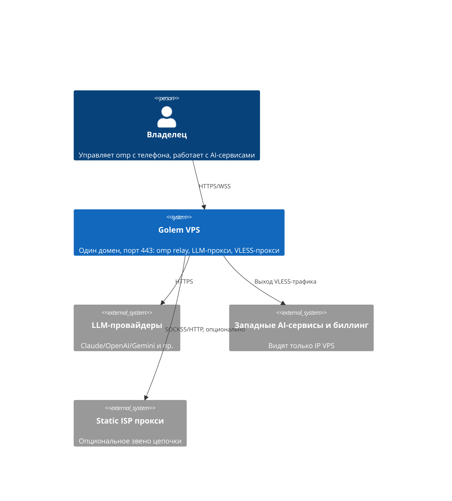

# AGENTS_BOOTSTRAP — карта проекта

Читать при входе в незнакомую область; правила работы — в `AGENTS.md`.

## Что это
Ansible-набор для развёртывания на дешёвом VPS (Debian 12, x86_64, 1 GB RAM) одного HTTPS-хоста на :443, за которым: веб-клиент и relay omp `/collab`, прокси LLM-API (cliproxyapi), VLESS+WS прокси. Подробно: `docs/requirements.md`.

## C4 L1 (System Context)

Остальные уровни — `docs/architecture/`.

## Карта документации (читать по задаче)

| Задача | Файл |
| :--- | :--- |
| Цели, ограничения, не-цели | `docs/requirements.md` |
| Открытые вопросы и непроверенное | `docs/open-questions.md` |
| Кто с кем общается (C4 L1–L2) | `docs/architecture/01-context.md`, `02-containers.md` |
| Порты, RAM-бюджет, фаервол, развёртывание | `docs/architecture/03-deployment.md` |
| Потоки трафика (omp, LLM, прокси, цепочка) | `docs/architecture/04-traffic-flows.md` |
| Почему так, а не иначе | `docs/decisions/` (ADR 0001–0012) |
| Caddy / Xray / cliproxyapi / omp relay | `docs/components/<имя>.md` |
| SSH, UFW, fail2ban, секреты (sops+age, инструкция для новичков) | `docs/components/security-baseline.md`, `docs/operations/secrets.md` |
| Мониторинг (Gatus), RAM-алерт, DuckDNS | `docs/components/ops-timers.md` |
| Клиенты: clash-verge-rev, v2rayN, Throne, Dolphin Anty | `docs/clients/` |
| Исследования и эксперименты (доступ клиентов к cliproxyapi, разделение портов SSH) | `docs/research/` |
| Структура Ansible, переменные | `docs/operations/ansible-layout.md`, `docs/reference/variables.md` |
| SSH-туннель к локальным UI (панель CPA, мониторинг), mise-задачи | `docs/operations/tunnel.md` |
| Тест на Lima, смоук-чеклист, сборка артефактов | `docs/operations/testing-lima.md`, `testing-mihomo.md`, `smoke-checklist.md`, `build-artifacts.md` |

## Структура репозитория (скелет)

| Путь | Назначение | Статус |
| :--- | :--- | :--- |
| `infra/ansible/` | инвентори, роли, плейбуки | все 11 ролей (base, firewall, ssh_hardening, caddy, xray, cliproxyapi, omp_relay, fail2ban, ops_timers, gatus, client_artifacts) проверены на Lima; bootstrap и prod не запускались |
| `infra/lima/` | шаблоны Lima для тестов | шаблон `vps-test.yaml` (не проверен) |
| `tests/mihomo/` | изолированный mihomo в Docker для проверки туннеля | проверен на stage; конфиг рендерится из `clients/generated/` |
| `build/` | артефакты сборки на Mac (в .gitignore) | заполняется `build:artifacts` |
| `scripts/` | `secrets.sh` (секреты), `build-artifacts.sh` (сборка) | готово |
| `mise.toml` | задачи: SSH-туннель (`tunnel:*`), `cpa:panel`, `secrets:*`, `build:artifacts`, `ansible:*`; параметры в `mise.local.toml` (вне git) | готово |
| `clients/templates/` | шаблоны клиентских конфигов (mihomo) | скелет |
| `docs/` | документация | заполнена в раунде 1 |
| `local/` | служебное, вне git | не коммитить, не удалять |
