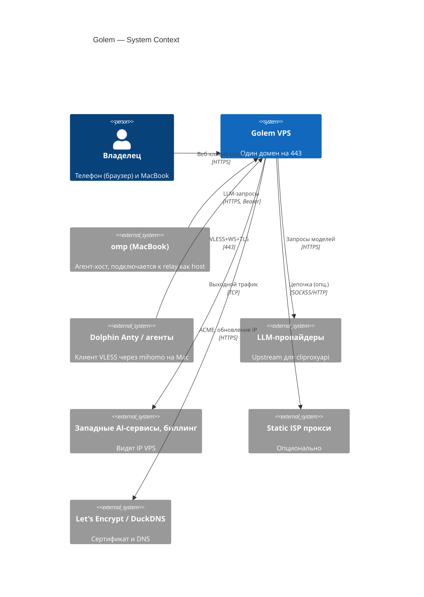

# C4 L1 — System Context

Читать, когда: нужна картина «кто пользуется системой и с чем она связана».

Нотация: C4 в Mermaid (`C4Context`/`C4Container`/`C4Deployment`), решение — `decisions/0008-c4-mermaid.md`. Диаграммы живут рядом с описанием, один уровень — один файл.

Границы: трафик содержимого collab шифруется end-to-end (AES-256-GCM), relay видит только room id и шифртекст. Ссылка с ключом = пароль.
