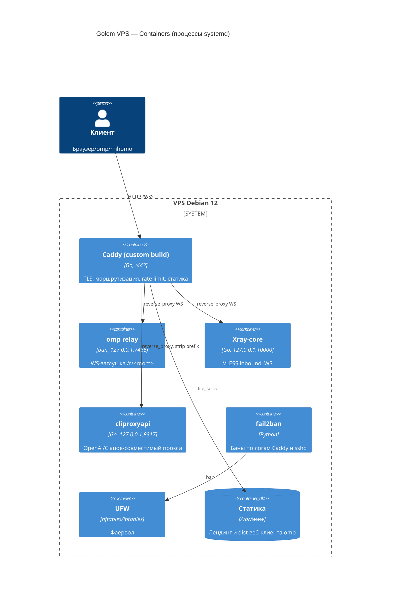

# C4 L2 — Containers и маршрутизация

Читать, когда: меняешь маршруты, порты, добавляешь сервис за Caddy.

## Таблица маршрутов (единственный источник правды)

| Путь | Условие | Назначение | Защита |
| :--- | :--- | :--- | :--- |
| `/<app_path>/*` | — | статика веб-клиента omp (префикс подтверждён) | секретный путь, rate limit |
| `/r/*` | заголовки `Upgrade: websocket` | omp relay :7466 | rate limit; ключ комнаты в ссылке. Путь фиксирован протоколом |
| `/<ws_path>` | заголовки `Upgrade: websocket` | Xray :10000 | UUID VLESS, rate limit |
| `/<llm_path>/*` | — | cliproxyapi :8317, префикс срезается | Bearer `access.api-keys`, rate limit |
| `cpa.golem:8317` (имя только внутри VLESS) | флаг `xray_cpa_route_enabled`; запрос приходит по `/<ws_path>` | Xray `freedom` → cliproxyapi 127.0.0.1:8317 (ADR 0012) | UUID VLESS, Bearer `access.api-keys`; белого списка Caddy нет |
| всё остальное | — | лендинг (статическая заглушка, 200) | — |

Правила:
- Пути `<app_path>`, `<ws_path>`, `<llm_path>` — случайные, генерируются Ansible на хост (`operations/secrets.md`), не слова вроде `/graphql`.
- Запрос без `Upgrade: websocket` на `/r/*` и `/<ws_path>` получает ответ лендинга/404, а не 400 от бэкенда: так активное зондирование не видит различий.
- Клиентам Xray ставить `alpn: http/1.1` (WS поверх h2 у Caddy не включаем).
- Логи Caddy — JSON в `/var/log/caddy/access.log`; fail2ban читает их.
