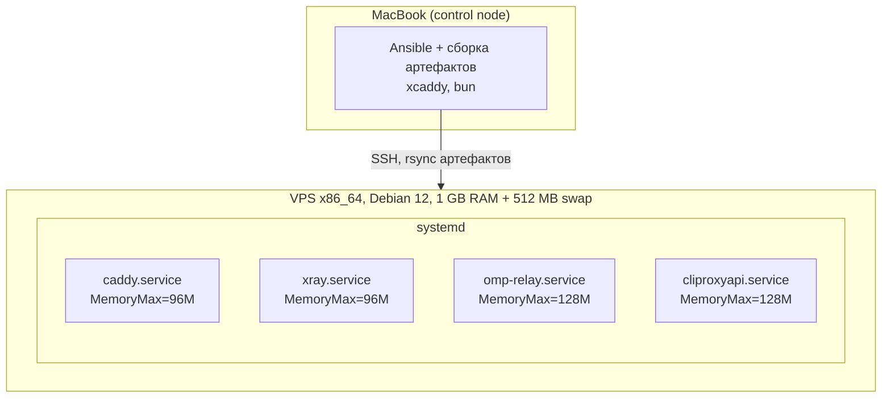

# C4 Deployment — VPS, порты, RAM

Читать, когда: правишь фаервол, лимиты systemd, выбираешь размер VPS.

## Порты
| Порт | Интерфейс | Кто | Открыт в UFW |
| :--- | :--- | :--- | :--- |
| 443/tcp | 0.0.0.0 | Caddy | да |
| `<ssh_port>`/tcp | 0.0.0.0 | sshd, ключи, без пароля | да (исключение из «только 443», ограничено fail2ban) |
| 80/tcp | — | не слушается; ACME через TLS-ALPN-01 | нет |
| 7466, 10000, 8317 | 127.0.0.1 | relay, Xray, cliproxyapi | нет |

## RAM-бюджет (частично измерено на aarch64 Lima; на x86 перемерить)
| Компонент | Покой | Нагрузка | `MemoryMax` |
| :--- | :--- | :--- | :--- |
| Debian minimal + sshd | ~130 MB | ~160 MB | — |
| Caddy | ~50 MB (измерено) | ~70 MB (оценка) | 96M |
| Xray | ~31 MB (измерено) | ~47 MB (пик cgroup 63) | 96M (+High 80M) |
| omp relay (bun compile) | ~16 MB (измерено) | ~32 MB (50 гостей) | 128M |
| cliproxyapi | ~50 MB (измерено RSS) | ~70 MB (оценка) | 128M |
| fail2ban | ~15 MB | ~25 MB | 64M |
| Gatus (опц.) | ~35 MB | ~35 MB | 64M |
| Итого (без Gatus) | ~292 MB | ~413 MB | — |

Критерий роста: при `MemAvailable < 100 MB` дольше 10 мин в нагрузочном тесте — брать +0.5 GB. Алерт: `components/ops-timers.md`.

## Базовая настройка ОС (роль `base`)
- Swap-файл 512 MB, `vm.swappiness=10`.
- Отключить лишние сервисы (в minimal-образах их обычно нет; роль проверяет и отключает только существующие юниты).
- `unattended-upgrades` только security.
- journald: `SystemMaxUse=50M` (экономия диска и RAM).
- Для каждого сервиса: отдельный пользователь без shell, `NoNewPrivileges`, `ProtectSystem=strict`, `ProtectHome`, `PrivateTmp`, `MemoryMax`/`MemoryHigh`.
