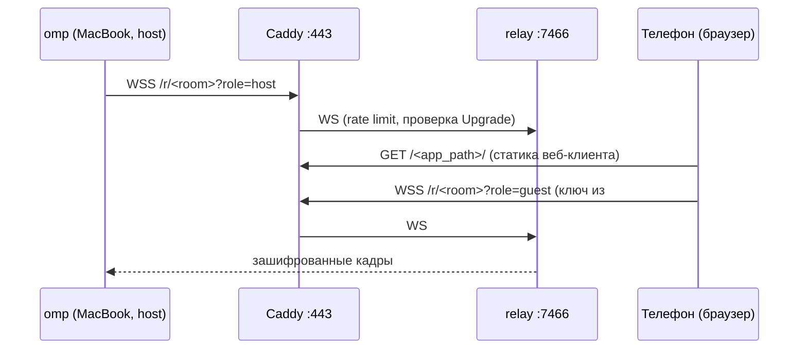
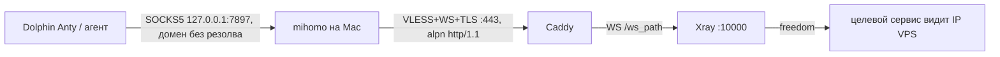

# Потоки трафика

Читать, когда: отлаживаешь конкретный сценарий или проектируешь цепочку прокси.

## A. omp /collab с телефона

Настройка omp: `collab.relayUrl = wss://<domain>`, `collab.webUrl = https://<domain>/<app_path>/`. Хост за прокси mihomo подчиняется `PI_PROXY_COLLAB`/`PI_PROXY`/`NO_PROXY`: домен VPS лучше добавить в `NO_PROXY`, чтобы не гонять relay через туннель до того же VPS.

## B. LLM-запросы с MacBook/виртуалки
`omp → https://<domain>/<llm_path>/v1 (Bearer) → Caddy (strip prefix) → cliproxyapi :8317 → LLM-провайдер`. Исходящий запрос cliproxyapi идёт напрямую с IP VPS (`requests.proxy-url` пуст) либо через static ISP прокси, если задан.

### B′. LLM через туннель (ADR 0012)
`агент → HTTP(S)_PROXY / socks5h mihomo → правило DOMAIN,cpa.golem → VLESS+WS+TLS :443 → Caddy → Xray → freedom (redirect 127.0.0.1:8317) → cliproxyapi`. Включается `xray_cpa_route_enabled`; адрес `http://cpa.golem:8317`, подключение агентов — `clients/ai-agents.md`. Без mihomo имя не резолвится.

## C. VLESS-прокси для Dolphin Anty и агентов

DNS: mihomo в режиме `fake-ip`/удалённого резолва, домен уходит внутрь туннеля; Xray резолвит у VPS.

## D. Цепочка с static ISP прокси (опционально)
Вариант 1 (рекомендуемый, только клиентский конфиг): в mihomo static ISP прокси описывается с `dialer-proxy: <узел VPS>`; Dolphin выбирает его. Трафик: Mac → VPS (VLESS) → static ISP прокси → цель. Целевой сервис видит IP static ISP; провайдер static ISP видит IP VPS, а не домашний. Тот же приём `dialer-proxy` описан в `clients/mihomo-clash-verge.md`.
Вариант 2 (серверный): outbound `socks`/`http` в Xray + routing по `email` пользователя. Включается переменной роли `xray_chain_*`, по умолчанию выключен.
