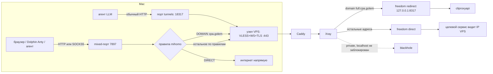

# Xray-core

Читать, когда: правишь VLESS inbound, пользователей, цепочку к static ISP прокси.

- Роль: `xray`. Бинарник — официальный релиз XTLS/Xray-core, версия и sha256 в `versions.yml`.
- Конфиг `/etc/xray/config.json` из шаблона. Inbound: `vless`, listen `127.0.0.1:10000`, `network: ws`, `wsSettings.path: /<ws_path>`, `security: none`, `decryption: none`, `clients: [{id: <uuid>, email: <label>}]`. Без `flow` (xtls-rprx-vision не работает с WS).
- Outbound по умолчанию: `freedom` (с `domainStrategy: UseIPv4`, если у VPS нет IPv6-маршрута), `blackhole` для блокировок, правило `geoip:private → block`, чтобы не ходить из туннеля в 127.0.0.1/LAN VPS.
- Маршрут к cliproxyapi (`xray_cpa_route_enabled`, по умолчанию выключен; ADR 0012): outbound `cpa` (`freedom`, `redirect 127.0.0.1:<cliproxyapi_port>`) и правило `domain: full:<xray_cpa_domain>` выше `geoip:private`. Известно: `localhost:8317` через VLESS не блокируется (правило по IP не видит имя), риск принят в ADR 0012.
- Цепочка на сервере (опционально, `xray_chain_enabled`): outbound `socks`/`http` на static ISP прокси + routing по `user`. По умолчанию выключено; основная цепочка — на клиенте (`architecture/04-traffic-flows.md`, вариант D).
- Логи: `loglevel: warning`, без access-логов (экономия диска, меньше следов).
- Systemd: `MemoryHigh=80M`, `MemoryMax=96M`, пользователь `xray` (системный, без shell; `DynamicUser` не используем: конфиг `root:xray 0640`), `XRAY_LOCATION_ASSET=/opt/xray/current` (geoip.dat/geosite.dat лежат рядом с бинарником в `/opt/xray/<ver>`, `current` — симлинк; без них правило `geoip:private` не загрузится). Конфиг проверяется `xray run -test` до записи.
- Клиентский профиль: `clients/mihomo-clash-verge.md`.
- Нагрузка (Xray v26.3.27, aarch64, без TLS): покой RSS ~31 MB; 5 потоков по 400 MB + короткие соединения — пик cgroup 63 MB; шквал 50 параллельных циклов — RSS 47 MB, без OOM. `MemoryMax=96M` достаточен. Пик смотреть в `/sys/fs/cgroup/system.slice/xray.service/memory.peak` (`systemctl show -p MemoryPeak` на systemd 252 пуст). Повторить на x86 при первом выкате.
- Xray предупреждает, что WebSocket-транспорт устарел (рекомендует XHTTP). Остаёмся на WS (совместимость с Caddy и клиентами); смена — новый ADR.

## Режимы доступа через VLESS: общий прокси и проброс порта

Читать, когда: путаешь «прокси» и «туннель», выбираешь, как агент или браузер попадёт на VPS. Слово «туннель» в документах означает два разных механизма, плюс отдельный SSH-туннель.

### Что общего
Во всех режимах клиент mihomo (clash-verge-rev) держит одно соединение VLESS+WS+TLS до VPS на 443: Caddy → `/<ws_path>` → Xray :10000. Отличается то, что принимает локальный порт на Mac и куда Xray отправляет запрос дальше.

### Режим 1. Общий прокси (mixed-порт, потоки C и D)
- Локальный порт — **mixed** (HTTP и SOCKS5 в одном, `mixed-port`; в шаблоне владельца 7897, в стенде `tests/mihomo` 17890). Он понимает команды прокси (`CONNECT`, SOCKS5), поэтому клиент сам указывает, куда ему нужно.
- Маршрутизирует **mihomo по правилам** (`rules:`): конкретное имя, домены, geoip или `MATCH`. Всё, что правило отправило в узел VPS, Xray выпускает наружу через `freedom`, целевой сервис видит IP VPS (`architecture/04-traffic-flows.md`, поток C).
- Годится для чего угодно, что умеет работать через прокси: браузер, Dolphin Anty, `curl -x`, агенты с `HTTP(S)_PROXY`/`PI_PROXY_*`/`pi-proxy-router`. Для софта без поддержки прокси нужен TUN (отдельный режим mihomo, здесь не используется).
- Требует настройки прокси **в каждом приложении** (или системного прокси). Если mihomo не запущен, приложение не работает или идёт мимо, в зависимости от настройки.
- `allow-lan`/открытый mixed-порт без `authentication:` — открытый прокси (`clients/mihomo-clash-verge.md`).

### Режим 2. Проброс порта (`tunnels:` в mihomo, ADR 0012)
- Локальный порт (по умолчанию `127.0.0.1:18317`, `GOLEM_CPA_LLM_PORT`) — **не прокси**. Это фиксированная пересылка TCP: что пришло на порт, mihomo отправляет через узел VPS на одну заданную цель `cpa.golem:8317` (строка `tcp,127.0.0.1:18317,cpa.golem:8317,<узел>`; готовая строка есть в `cpa-access.txt`).
- Команд прокси порт не понимает. Если подключить к нему браузер как к прокси, ничего полезного не получится, а другие сайты через него недоступны. Он отвечает как cliproxyapi, будто тот запущен на Mac.
- Агенту не нужны ни `HTTP(S)_PROXY`, ни `NO_PROXY`, ни `pi-proxy-router`: он просто ходит на `http://127.0.0.1:18317`. TUN не нужен. Это основной режим доступа LLM-агентов (`clients/ai-agents.md`).
- Проверено: mihomo `tunnels:` на Lima и stage (401/200, SSE). Для v2rayN аналог не изучен (Q15).
- Если клиент VLESS остановлен, порт закрыт: `Connection refused`; pi падает сразу, omp и ccs повторяют попытки.

### Режим 2б. Прокси-режим с именем `cpa.golem` (запасной для LLM)
- Агент настраивается на mixed-порт (режим 1) и ходит на `http://cpa.golem:8317`; правило `DOMAIN,cpa.golem,<узел>` отправляет имя в узел, Xray по правилу `domain: full:cpa.golem` подставляет `127.0.0.1:8317` (`freedom` с `redirect`). Имени в DNS нет: без mihomo оно не резолвится (fail-closed).
- Нужен там, где клиент VLESS не умеет `tunnels:`, но умеет правила по домену.

### Сводка

| | Mixed-порт (режим 1, 2б) | Проброс порта `tunnels:` (режим 2) | SSH-туннель (`operations/tunnel.md`) |
| :--- | :--- | :--- | :--- |
| Что слушает на Mac | HTTP/SOCKS5-прокси | пересылка TCP на одну цель | `ssh -L`, пересылка на одну цель |
| Куда может попасть трафик | куда решат правила mihomo | только cliproxyapi (`cpa.golem:8317`) | заданные в `GOLEM_TUNNEL_FORWARDS` порты loopback VPS |
| Настройка в агенте | нужен прокси | не нужна | не нужна |
| Транспорт | VLESS+WS+TLS :443 | VLESS+WS+TLS :443 | SSH на порту sshd |
| Нужен ли TUN | нет | нет | нет |
| Весь трафик системы через VPS | нет, только то, что отправлено в прокси (для остального — TUN или системный прокси) | нет | нет |

### Что «туннель» не означает
- Подключение браузера или другого приложения к порту `tunnels:` не пропустит его трафик через VPS: для общего выхода используется mixed-порт.
- Ни режим 1, ни режим 2 сами по себе не заворачивают трафик всей системы; TUN в проекте не применяется.
- Выход в интернет с VPS (режим 1) и доступ к loopback VPS (режим 2) разделены в Xray: в режиме 1 правило `geoip:private → blackhole` не даёт ходить на частные адреса VPS; в режиме 2 исключение стоит строго для одного имени. Известная оговорка (`localhost:8317` не блокируется) — в ADR 0012.
